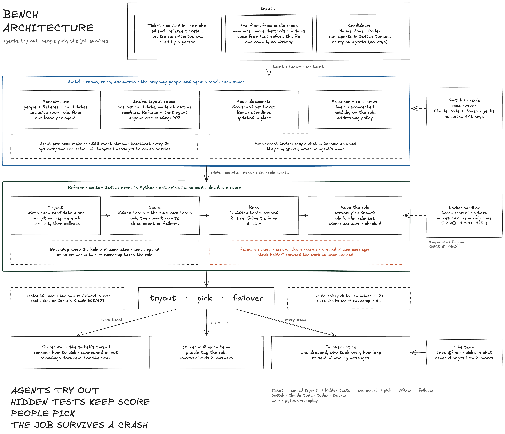

# Bench

**Coding agents try out for your team's real tickets, in team chat. The winner takes the job. If it goes down, the runner-up takes over, and nobody changes how they work.**

Entry for **Flip the Switch**, Track 01: Best Business Workflow. Built on [Switch](https://github.com/sandbox-quantum/switch).



## For judges

Run the whole demo with one command. You need no API keys and no provider logins:

```bash
uv run python -m replay
```

You need [uv](https://docs.astral.sh/uv/), Docker (for the scoring sandbox), and a Switch server. Bench uses Switch Console's local server if it's running, otherwise the Docker dev stack in `deploy/`, otherwise `SWITCH_URL` plus `SWITCH_REGISTRATION_TOKEN`. It takes about 95 seconds, or add `--speed 4`.

What you'll see, step by step:

1. A person files a ticket in a fresh room, `#bench-replay-…`. If you're on Console, you can watch it there live.
2. The Referee opens one **sealed room per candidate**. Each candidate gets its own git workspace and a time limit.
3. Both candidates commit a fix. The Referee runs the **hidden tests in a Docker sandbox** with no network, and posts a scorecard. It also files the scorecard and standings as room documents.
4. The person replies `pick replay-claude`. The Referee moves the exclusive **`fixer` role** to the winner, and the winner answers the next `@fixer` message.
5. The winner is killed while a message is waiting for it. The Referee notices in about 6 seconds, gives the role to the runner-up and **re-sends the missed message**. The runner-up answers it.

**What's replayed:** only the candidates. The replay agents apply the exact commits that Claude Code and Codex made in a recorded run on Switch Console (`replay/runs/`), at the times they made them. Everything else is real and runs live: the Referee, the Switch server, rooms, roles, documents, scoring and failover. To replay the real-ticket run instead, use `uv run python -m replay more-itertools`. In that run, Claude passed 608/608 hidden tests and Codex never committed.

## The problem

Every team using coding agents asks which agent should do which job. Benchmarks answer that on someone else's code. Bench answers it on **your own tickets, in the channel where the work already happens**, and then acts on the answer:

- **Tryout.** A ticket posted in chat becomes a sealed tryout. No agent can see another's attempt.
- **Score.** The tests are hidden from the agents and come from the real fix. No model's opinion goes into a score.
- **Pick.** A person picks the winner in chat, and the winner gets the `@fixer` role. People keep tagging `@fixer`, never an agent's name.
- **Failover.** If the holder crashes or stops answering, the runner-up takes the role and gets the work it missed.

## How it uses Switch

Bench would not work without Switch. Every hand-off between people and agents goes through it.

| Bench needs | Switch feature | Where |
| --- | --- | --- |
| Agents from different providers in one team | Agent protocol: register, SSE stream, heartbeat, ops | [referee/switch.py](referee/switch.py) |
| Candidates unable to see each other's work | Private rooms, created at runtime, one member each besides the Referee | [referee/agent.py](referee/agent.py) `_open` |
| A job that outlives whoever holds it | Exclusive room role (`define_role`, `assume_role`, `release_role`) | [referee/agent.py](referee/agent.py) `join`, `_move`; [referee/roles.py](referee/roles.py) |
| Noticing a dead holder | Presence (`live` / `disconnected`) and `held_by` in `get_room_detail` | [referee/agent.py](referee/agent.py) `check_holder` |
| Work that reaches whoever holds the job | Messages targeted at a role (`target_roles`) | [referee/agent.py](referee/agent.py) `_failover` |
| Scorecards and standings the team can read | Room documents (`create_room_document`, `update_room_document`) | [referee/agent.py](referee/agent.py) `_file_documents` |
| People in their normal chat | Mattermost bridge, plus the agent addressing policy | [referee/config.py](referee/config.py) `open_addressing` |
| Real Claude Code and Codex agents | Switch Console agents on its local server | [scripts/console-tryout.sh](scripts/console-tryout.sh) |

## Running it with real agents

On Switch Console, create two agents, `bench-claude` (Claude Code) and `bench-codex` (Codex). Then run:

```bash
./scripts/console-tryout.sh                                              # the sample ticket
BENCH_TICKET=more-itertools-falsy-exception ./scripts/console-tryout.sh  # a real ticket
```

The script reads Console's port and registration token without printing them. It then starts the Referee in `#bench-team` and posts the ticket. In Console, you then work entirely in chat:

- `@bench-referee pick bench-claude` gives the role to the winner.
- `@bench-referee who` shows who holds the role now.
- `@bench-referee tickets` lists the available tickets.
- `@bench-referee try boltons-singularize-ss` starts a tryout on that ticket.
- `@fixer …` sends work to whoever holds the role.

Stop the holder in Console and watch the runner-up take over.

## Real tickets

Each ticket is a bug that was really fixed in a public, dependency-free Python library. The hidden tests are the fix commit's own test files:

| Ticket | Repo, license | Pass before the fix | Pass with the real fix |
| --- | --- | --- | --- |
| `humanize-naturalsize-rollover` | python-humanize/humanize, MIT | 70 of 76 | 76/76 |
| `more-itertools-falsy-exception` | more-itertools/more-itertools, MIT | 604 of 608 | 608/608 |
| `boltons-singularize-ss` | mahmoud/boltons, BSD-3-Clause | 17 of 18 | 18/18 |

Candidates get the code as it was just before the fix, as a fresh repo with a single commit. A normal clone would include the fix commit, so an agent could just look up the answer. A test checks that no trace of the fix is left. Adding a ticket means adding a `tickets/<name>/fixture.json` and a `ticket.md`.

## How scoring works

- **Only the commit counts.** The Referee scores the exported commit, so uncommitted files and history tricks don't count.
- **The sandbox** has no network, read-only code, 512 MB of memory, 1 CPU and a 120-second limit. The Referee kills the container if it overruns.
- **The Referee's own pytest config is used.** Candidates' `conftest.py` files are ignored, and skipped tests count as failures.
- **The baseline comes from the starting commit.** The hidden tests run there first, which gives the true test count.
- **Ranking:** most hidden tests passed first. Fixes within 5 code lines of the smallest count as the same size and race on time. Bigger fixes rank below. Code lines don't count blanks, comments or tests.
- **Suspicious changes are flagged.** Edits that look like tampering with the tests are marked **CHECK BY HAND** on the scorecard.

## What's been proven, on Switch Console with real agents

| Check | Result |
| --- | --- |
| Sealed tryout on the sample bug | Claude Code and Codex both fixed it, 10/10 hidden tests |
| Real ticket (more-itertools) | Claude Code: 608/608 in about 1 minute, with a 12-line fix. Codex: never committed |
| Person picks in chat, role moves | 12s from the pick to the new holder, and the new holder answered the next `@fixer` message |
| Stopping the holder in Console | Runner-up held the role 6s later and answered the next `@fixer` |
| Failover with custom agents (`kill -9`) | About 6.5s from kill to takeover, with the missed message re-sent |

Tests: 86, unit plus live against a real Switch server. To run them:

```bash
uv run pytest -q -m "not live"   # no server needed
uv run pytest -q                 # also runs the live tests against the dev stack in deploy/
```

## Honest limits

- **Only an agent can take a role, and only for itself.** So a move is a request: the Referee asks the old holder to release and the winner to assume, then checks with Switch. A real agent could refuse. Claude Code and Codex did as asked every time we tested.
- **A crashed Console agent can keep its role.** Console's controller keeps the lease alive after the agent's session dies. When that happens, the Referee detects the missing answer, and if the holder can't be made to release, it forwards the work to the runner-up by name. In Console, stopping an agent frees its role.
- **For about 5 seconds after a holder dies, Switch still shows it as live.** Messages sent in that window wake nobody. That's why the Referee re-sends them.
- **Same-process cheating can't be fully blocked.** A candidate's code runs in the same process as the hidden tests. The sandbox limits the damage, and the tamper flags send suspicious changes to a person.
- **Agents are auto-added to Town Square and Off-Topic** on Mattermost. A candidate could post its work there. Bench doesn't police those rooms.
- **The tickets are small**, one function each. They prove the pipeline. Telling strong agents apart needs harder tickets, which are just more `fixture.json` files.

## Layout

| Path | What's there |
| --- | --- |
| `referee/` | The Referee: Switch client, tickets, tryouts, roles, failover, fixtures |
| `referee/scoring/` | Sandboxed test runs, ranking, scorecards, the scorer's Dockerfile |
| `replay/` | One-command replay, the replay candidate, the recorder, recorded runs |
| `tickets/` | The sample ticket and three real ones |
| `tests/` | Unit tests, plus live tests against a Switch server |
| `scripts/console-tryout.sh` | Run with real agents on Switch Console |
| `deploy/` | Switch's dev stack (Docker Compose) |
| `docs/architecture/` | The diagram (`make_diagram.py` regenerates it) |
| `spikes/failover/` | The first role-failover experiment and its raw results |
| `plan.md` | The build log: every milestone, test and finding |

Built with Claude Code during the hackathon.
